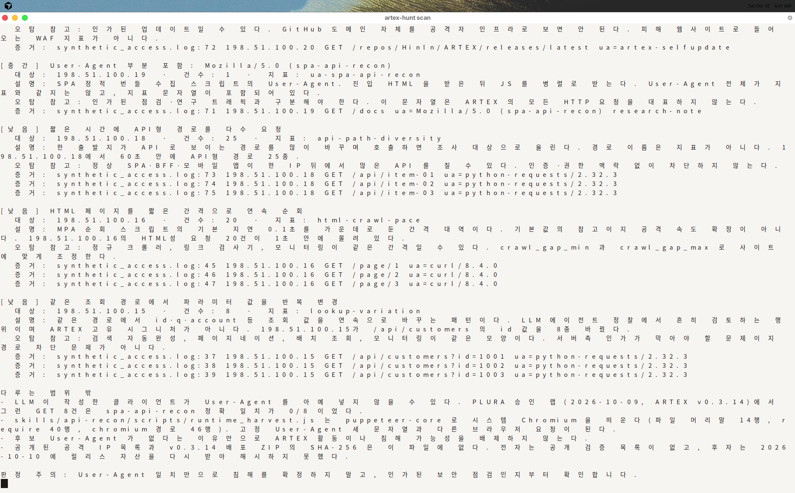
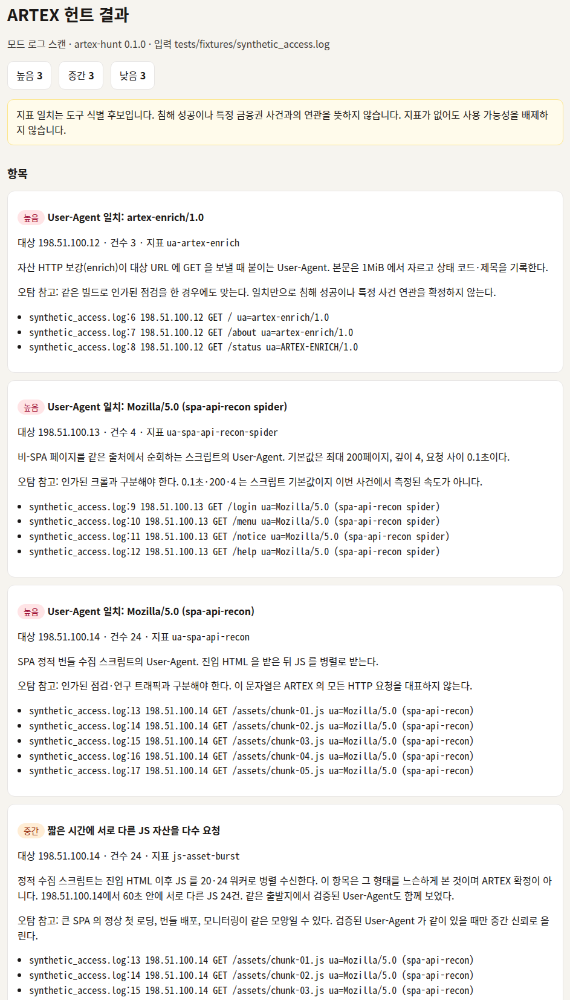
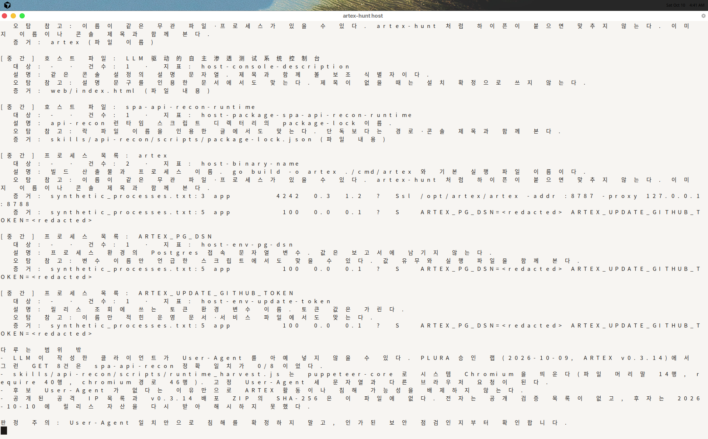
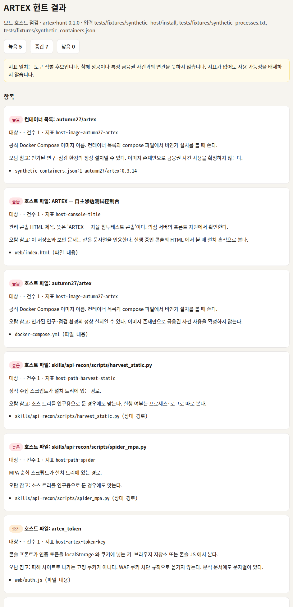

# artex-defense-kit

ARTEX 공개 소스에서 확인한 식별 문자열과, 그 문자열이 대표하지 못하는 요청을 보완하는 행위 휴리스틱으로 로그와 호스트를 점검하는 방어 도구입니다. 공격 기능은 없습니다.

작성: 최규선 (정보관리기술사). 관련 글은 [아르텍스(ARTEX) AI 침투 도구, 금융권 해킹과 무슨 관계일까?](https://최규선.com/posts/4) 입니다.

## 개요

`artex-hunt` 는 웹 서버·WAF·프록시 로그(nginx/apache combined, IIS W3C, JSON Lines)에서 검증된 User-Agent 와 조정 가능한 행위 휴리스틱을 찾고, 디렉터리·프로세스 목록·컨테이너 목록에서 설치 흔적을 봅니다. 결과는 한국어 요약, JSON, HTML 입니다.

탐지 예시는 Sigma, Suricata, ModSecurity 로 `rules/` 에 있습니다. ModSecurity 예시는 탐지 전용(`pass,log`)입니다.

## 배경

ARTEX 는 공개된 LLM 다중 에이전트 침투 테스트 시스템입니다. 라이선스는 AGPL-3.0 이고, 플래너와 워커가 역할을 나눕니다. 2026년 10월 국내 금융권 침해 보도에서 이름이 언급되었고, 이 저장소를 쓰는 시점에도 그 연관은 수사·조사 중이며 공식 확인 전입니다.

PLURA 는 2026-10-03 1보에서 공개 소스의 User-Agent 세 개를 후보로 제시하면서, 금융권 공격 로그와 대조해 검증한 값은 아니라고 밝혔습니다. 2026-10-09 랩 공개에서는 LLM 이 만든 요청 8건에 그 User-Agent 가 없었고 헤더 자체가 없었습니다. 안랩 ASEC 은 인터넷에 노출된 콘솔과 주변 인프라를 추적해 공개했고, 발견만으로 악성으로 보지 말라고 했습니다.

이 저장소는 그 공백을 메우는 탐지 쪽 정리입니다. ARTEX 를 실행하거나, 소스를 포함하거나, 공격을 재현하지 않습니다.

## 분석 요약

직접 읽은 트리는 Hinln/ARTEX `f3e3f54` (2026-10-08)입니다. v0.3.14 를 못 박은 커밋 `86162d7` 에서도 같은 식별 문자열을 확인했습니다. 2026-10-10 에 Autumn-27/ARTEX 는 공개 HTTPS 에서 404 였습니다.

들어오는 요청에서 전체 일치로 쓰는 값은 세 개입니다.

- `artex-enrich/1.0` (`enrich/enrich.go:233`)
- `Mozilla/5.0 (spa-api-recon)` (`skills/api-recon/scripts/harvest_static.py:23`)
- `Mozilla/5.0 (spa-api-recon spider)` (`skills/api-recon/scripts/spider_mpa.py:22`)

`artex-selfupdate` 는 설치본이 GitHub 를 볼 때 쓰는 값이라 아웃바운드 로그용입니다. 호스트에서는 이미지 `autumn27/artex`, 콘솔 제목, `artex_token` 키, 실행 파일 이름 `artex` 를 봅니다. 8787·8788 포트와 UI 목업의 `ARTEX-worker/1.0`, `/api/` 같은 경로 접두사, 검증하지 못한 IP·해시는 탐지 항목이 아닙니다.

자세한 인용은 [구조](docs/analysis/01-아키텍처.md), [지문](docs/analysis/02-관측-지문.md), [채택과 제외](docs/analysis/03-지표-판정.md)에 있습니다.

## 기능

- combined, IIS W3C, JSON Lines 파싱. 형식은 파일마다 자동 구분합니다.
- 검증된 User-Agent 는 높은 신뢰(업데이트용 문자열은 중간). 일부만 포함되면 한 단계 낮춥니다.
- JS 자산 폭주, API형 경로 다양성, 조회 파라미터 반복, HTML 단기 순회. 기본 임계값은 바꿉니다. 단독으로는 낮은 신뢰이고, 검증된 User-Agent 가 같은 출발지에 있으면 중간으로 올립니다.
- 호스트 점검. 넘겨준 디렉터리와 목록 파일만 읽습니다. 토큰 값은 가립니다.
- 한국어 터미널 요약, JSON, HTML.

## 설치

Python 3.11 이상이 필요합니다.

```bash
python -m venv .venv
source .venv/bin/activate
pip install -e ".[dev]"
```

개발 의존성 없이 도구만 설치하려면 `pip install -e .` 입니다.

## 사용법

합성 로그만 들어 있습니다. 실제 사고 캡처가 아닙니다.

```bash
artex-hunt scan tests/fixtures/synthetic_access.log \
  --json /tmp/artex-scan.json \
  --html /tmp/artex-scan.html

artex-hunt scan tests/fixtures/synthetic_iis.log tests/fixtures/synthetic_json.log

artex-hunt scan tests/fixtures/synthetic_access.log \
  --distinct-js 40 --lookup-variants 20 --min-confidence high

artex-hunt host \
  --directory tests/fixtures/synthetic_host/install \
  --processes tests/fixtures/synthetic_processes.txt \
  --containers tests/fixtures/synthetic_containers.json
```

`--fail-on high` 는 그 신뢰도 이상 항목이 있으면 종료 코드 2를 돌려 배치 점검에 붙일 수 있습니다. `--no-heuristics` 는 User-Agent 만 봅니다.

아래 화면은 위 합성 표본을 실제로 돌린 결과입니다. 꾸며 만든 이미지가 아닙니다.









임계값 기본값과 출처는 `src/artex_hunt/data/indicators.yaml` 의 `heuristics` 입니다. `--window`, `--distinct-js`, `--distinct-api`, `--lookup-variants`, `--crawl-requests` 가 그 값을 덮어씁니다.

## 탐지 룰

| 파일 | 용도 |
| --- | --- |
| `rules/sigma/artex_recon_user_agent.yml` | 인바운드 세 User-Agent |
| `rules/sigma/artex_selfupdate_user_agent.yml` | 아웃바운드 업데이트 User-Agent. 인바운드 WAF 용이 아님 |
| `rules/sigma/artex_process_name.yml` | 프로세스 이미지 이름이 `artex` 로 끝남 |
| `rules/suricata/artex_user_agents.rules` | 위 User-Agent 의 예시 시그니처. `alert` 만 |
| `rules/modsecurity/artex-user-agents.conf` | 탐지 전용 `pass,log` |

운영 반영 전에 정상 로그로 오탐을 보고, 인가된 점검 출발지를 예외로 둡니다. 설명은 [rules/README.md](rules/README.md)와 [방어 가이드](docs/방어-가이드.md)에 있습니다.

## 한계

- 세 User-Agent 는 일부 모듈의 값입니다. LLM 이 작성한 클라이언트와 Chromium 런타임은 다른 헤더를 쓰거나 헤더가 없습니다.
- 행위 휴리스틱은 ARTEX 확정이 아닙니다. 큰 SPA, 검색창, 모니터링이 같은 모양일 수 있습니다.
- combined 로그는 초 단위라, HTML 순회의 0.1초를 직접 재지 않고 구간 길이로 환산합니다.
- 포트, 경로 접두사, 목업 User-Agent `ARTEX-worker/1.0` 은 일부러 탐지하지 않습니다.
- 공격 IP 와 배포 ZIP SHA-256 은 이 버전에서 다시 검증하지 못해 넣지 않았습니다.
- 도구는 로컬 파일만 읽습니다. 상대 시스템을 스캔하지 않고, 침해 여부를 판정하지 않습니다.

## 면책

이 소프트웨어는 있는 그대로 제공합니다. 탐지 결과는 조사 시작점입니다. 지표가 보인다는 사실, 그 요청이 비인가라는 판단, 데이터가 나갔다는 판단은 서로 다릅니다. 인가되지 않은 시스템에 대한 접근을 돕지 않으며, 그런 용도로 쓸 수 없습니다.

라이선스 선택과 ARTEX 라이선스와의 관계는 [NOTICE.md](NOTICE.md)에 있습니다. 이 저장소의 글과 코드는 MIT 입니다. ARTEX 소스에서 프로그램 표현을 복사하지 않았습니다. 지표는 짧은 리터럴과 줄 번호 인용입니다.

## 출처

- Hinln/ARTEX `f3e3f54b6c93916388a0a3dc6a439893a9abe37a`, AGPL-3.0. https://github.com/Hinln/ARTEX
- 같은 트리의 v0.3.14 changelog 커밋 `86162d7edac41afcdd82d8de9ecab512b7e014d6`
- PLURA 1보, 2026-10-03. https://blog.plura.io/ko/respond/financial-sector-hacking-ioc-artex-1st-report/
- PLURA LLM 랩, 2026-10-09. https://blog.plura.io/ko/column/howto-artex-llm/
- AhnLab, 노출 인프라. https://www.ahnlab.com/ko/contents/content-center/36299
- AhnLab, ARTEX v2 추적. https://www.ahnlab.com/ko/contents/content-center/36300
- KISA 118. https://www.kisa.or.kr/118

테스트는 `pytest`, 정적 검사는 `ruff check` 와 `ruff format --check` 입니다. 합성 표본은 `tests/fixtures/` 에 있습니다.
